# Stockroom

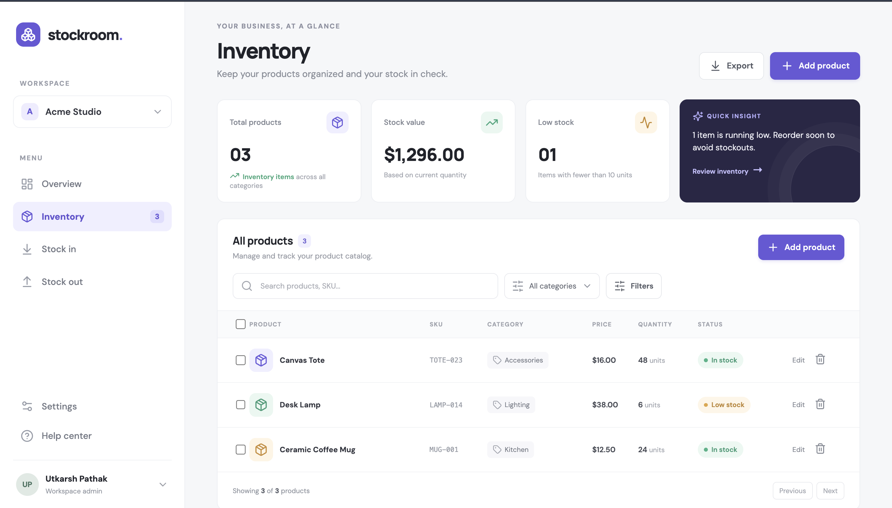

**A full-stack inventory CRUD application with a containerized delivery pipeline and a locally deployed Kubernetes demo.** Stockroom helps a small team track products, categories, quantities, and stock value. This repository demonstrates the path from a code change through automated tests and security scans to a versioned container image and a Helm-managed Kind deployment.

[](https://github.com/31UTKARSH07-ALPHA/Stockroom/actions/workflows/ci-cd.yml)
[View the repository](https://github.com/31UTKARSH07-ALPHA/Stockroom) · [Demo walkthrough](DEMO.md) · [Grading evidence](#rubric-and-evidence)

> **Deployment scope:** Docker Compose and Kubernetes run locally. Terraform contains an AWS VPC/EKS reference configuration, but no AWS plan or resources were created. This project intentionally uses no AWS services.

## What the application does

Stockroom provides a responsive inventory dashboard to:

- Create, list, view, edit, and delete products.
- Record a SKU, product name, category, quantity, and price.
- Search and filter the product catalog and review inventory totals.
- Export inventory as CSV. Values are quoted and escaped; spreadsheet formula-leading text is guarded.

The FastAPI backend provides CRUD routes, health/readiness checks, and Prometheus metrics. PostgreSQL stores products, and Alembic manages the schema migration.

## Architecture

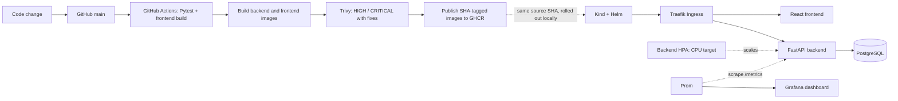

The GitHub Actions workflow tests, builds, scans, and publishes images. The local Kind rollout is a separate demonstration step; the workflow does not deploy to a cloud cluster.

## Technology

| Area | Tools |
| --- | --- |
| Frontend | React, Vite, Nginx |
| API | Python 3.12, FastAPI, SQLAlchemy |
| Data | PostgreSQL 16, Alembic |
| Tests | Pytest, isolated SQLite test database |
| Local containers | Docker, Docker Compose |
| CI and registry | GitHub Actions, GHCR |
| Image security | Trivy |
| Local orchestration | Kubernetes (Kind), Helm, Traefik Ingress |
| Observability | Prometheus, Grafana |
| Infrastructure reference | Terraform for AWS VPC/EKS (not applied) |

## Run with Docker Compose

**Requirements:** Docker Desktop or Docker Engine with the Compose plugin.

From the repository root:

```bash
docker compose up --build -d
```

Open the application at <http://localhost:3000>. The API documentation is at <http://localhost:8000/docs>; health and metrics are available at `/health`, `/ready`, and `/metrics` on port 8000. Compose starts PostgreSQL, waits for it to become healthy, and applies the Alembic migration as the backend starts.

```bash
docker compose ps
docker compose down
```

Add `-v` to `docker compose down` only when you also want to remove the local PostgreSQL data volume. Compose defaults are for local learning; set your own environment values before using the stack with non-demo data.

## Run tests

The backend tests use an isolated SQLite database through the test fixtures; they do not connect to the Compose database.

```bash
cd backend
python -m venv .venv
source .venv/bin/activate
pip install -r requirements.txt
pytest -v
```

The suite contains six API tests covering product operations and metrics. `pytest.ini` configures the test import path.

## CI/CD and image security

Workflow: [`.github/workflows/ci-cd.yml`](.github/workflows/ci-cd.yml)

On pushes and pull requests targeting `main`, GitHub Actions installs backend dependencies, runs Pytest, installs frontend dependencies, and builds the frontend. On pushes to `main`, a dependent job then:

1. Builds the backend and frontend container images.
2. Scans both images with Trivy for OS and library vulnerabilities.
3. Fails on HIGH or CRITICAL findings that have a fix available.
4. Publishes both images to GHCR with the full source commit SHA as the tag.

```text
ghcr.io/31utkarsh07-alpha/stockroom-backend:<commit-sha>
ghcr.io/31utkarsh07-alpha/stockroom-frontend:<commit-sha>
```

The workflow needs the repository Actions setting to allow `GITHUB_TOKEN` package writes. It does not contain registry passwords or AWS credentials.

### Security finding and fix

An earlier backend scan identified HIGH [Starlette CVE-2025-62727](https://avd.aquasec.com/nvd/cve-2025-62727) in version 0.46.2. A Prometheus instrumentation dependency constrained the Starlette version. The project removed that dependency and records request metrics directly with `prometheus-client`, allowing FastAPI to resolve a fixed Starlette version. Trivy remains configured to block actionable HIGH and CRITICAL findings; vulnerabilities without an upstream fix are excluded from the blocking threshold.

## Local Kubernetes deployment

The Kind setup uses Docker Desktop, Traefik, and the Stockroom Helm chart. It creates no cloud resources. Install Docker, `kind`, `kubectl`, and Helm first.

Create the cluster and namespace:

```bash
kind create cluster --name stockroom --config k8s/kind-config.yaml
kubectl apply -f k8s/namespace.yaml
```

Build and load the local images, install Traefik, and deploy the app:

```bash
docker build -t stockroom-backend:local ./backend
docker build -t stockroom-frontend:local ./frontend
kind load docker-image stockroom-backend:local stockroom-frontend:local --name stockroom

helm repo add traefik https://traefik.github.io/charts
helm repo update traefik
helm upgrade --install traefik traefik/traefik --version 42.0.0 \
  --namespace ingress-system --create-namespace \
  -f helm/traefik-values.yaml --wait
helm upgrade --install stockroom helm/stockroom \
  --namespace stockroom --wait
```

Open <http://127.0.0.1:8080>. Kind maps this IPv4 host port to the Traefik HTTP NodePort; using `127.0.0.1` avoids hosts where `localhost` resolves to a different IPv6 listener. The Ingress sends `/` to the frontend and `/api` to the backend.

```bash
kubectl get pods,svc,ingress -n stockroom -o wide
helm status stockroom -n stockroom
curl http://127.0.0.1:8080/health
```

The chart runs two frontend replicas. Backend replicas start at two and are managed by a CPU-based HPA (2–5 replicas). Its PostgreSQL pod uses demo credentials and ephemeral storage. Treat this as a local demonstration, not a persistent production database. To remove the cluster, run `kind delete cluster --name stockroom`.

### Roll out a CI-built source revision locally

Use the full commit SHA from a successful Actions run. Build and load the matching frontend image, then set the Helm image tag to that same SHA:

```bash
IMAGE_TAG=<full-commit-sha>
docker build -t stockroom-frontend:$IMAGE_TAG ./frontend
kind load docker-image stockroom-frontend:$IMAGE_TAG --name stockroom
helm upgrade --install stockroom helm/stockroom --namespace stockroom \
  --set frontend.image.tag=$IMAGE_TAG --wait
kubectl rollout status deployment/stockroom-frontend -n stockroom
kubectl get deployment stockroom-frontend -n stockroom -o wide
```

This local rollout makes the source-to-image-to-deployment relationship visible; it is not an automated cloud deployment.

### Backend autoscaling

The chart defines a `autoscaling/v2` HPA for `stockroom-backend`: minimum 2, maximum 5 replicas, and a 50% average CPU utilization target. The backend CPU request is 100m, so the target corresponds to 50m average CPU per pod. The Deployment omits `spec.replicas` while autoscaling is enabled, preventing a Helm upgrade from resetting the HPA's desired count.

Kind has no resource metrics API by default. Install the official [metrics-server v0.9.0](https://github.com/kubernetes-sigs/metrics-server/releases/tag/v0.9.0) manifest and add the Kind kubelet certificate flag with the idempotent helper:

```bash
./scripts/install-metrics-server-kind.sh
```

Upgrade the existing release while reusing its prior values (including any frontend image tag) and enabling the HPA settings:

```bash
helm upgrade stockroom helm/stockroom -n stockroom --reuse-values \
  --set backend.autoscaling.enabled=true \
  --set backend.autoscaling.minReplicas=2 \
  --set backend.autoscaling.maxReplicas=5 \
  --set backend.autoscaling.targetCPUUtilizationPercentage=50 --wait
```

Check that metrics are available and the HPA has a real current CPU value:

```bash
kubectl top nodes
kubectl top pods -n stockroom
kubectl get hpa -n stockroom
```

Start a temporary BusyBox load pod. By default, it runs 12 paced concurrent loops against the real database-backed `/api/products` endpoint through the `stockroom-backend` Service. Set `HPA_LOAD_WORKERS` before running the script to tune concurrency for the host:

```bash
./scripts/start-backend-hpa-load.sh
kubectl get hpa -n stockroom -w
```

Wait until `TARGETS` reports CPU and `REPLICAS` rises above 2, then inspect the pods:

```bash
kubectl get pods -n stockroom
```

Stop the load and verify the HPA begins reducing its desired count (the default scale-down stabilization window can take about five minutes):

```bash
kubectl delete pod stockroom-hpa-load -n stockroom --wait=true
kubectl get hpa -n stockroom -w
```

The test pod is temporary and can be recreated with the script. The other `backend` Service is a compatibility alias used by the frontend's Nginx proxy; it selects the same backend pods and is retained unchanged.

## Observability with Prometheus and Grafana

Prometheus and Grafana are installed inside the local Kind cluster with the repository values files. Start Docker Desktop and the `stockroom` Kind cluster first.

```bash
helm repo add prometheus-community https://prometheus-community.github.io/helm-charts
helm repo add grafana-community https://grafana-community.github.io/helm-charts
helm repo update prometheus-community
helm repo update grafana-community

helm upgrade --install prometheus prometheus-community/prometheus --version 29.35.0 \
  --namespace observability --create-namespace \
  -f observability/prometheus-values.yaml --wait
helm upgrade --install grafana grafana-community/grafana --version 14.0.0 \
  --namespace observability \
  -f observability/grafana-values.yaml --wait
```

In separate terminals, forward the services:

```bash
kubectl port-forward -n observability service/prometheus-server 9090:80
kubectl port-forward -n observability service/grafana 3001:80
```

- Prometheus: <http://localhost:9090/targets>. The `stockroom` job should show two backend targets as `UP`.
- Grafana: <http://localhost:3001/d/stockroom-overview/stockroom-api-overview>. The local demo login is `admin` / `stockroom-local`.
- Backend metrics: <http://127.0.0.1:8080/metrics>.

The dashboard includes request-rate and latency panels. Prometheus retention and demo data are ephemeral. Do not reuse the sample Grafana credentials outside this local environment.

## Terraform reference: AWS (not deployed)

[`terraform/`](terraform/) contains HCL for a VPC with two public subnets, an EKS control plane, and a managed node group. `terraform init` and `terraform validate` succeeded. No AWS plan, apply, or destroy was run, and no AWS resources were created, because this project was scoped to use no AWS. Therefore the AWS provisioning and teardown criteria are **not fulfilled**. The example variables file contains no real credentials. See [`terraform/README.md`](terraform/README.md) for the reference workflow and cost notes.

## Rubric and evidence

The evidence files below are committed in [`evidence/`](evidence/). Expand a module to view its screenshots. The table reports implementation/evidence status against the supplied 100-point rubric; it does not claim an instructor-awarded grade.

| Module | Weight | Status in this project | Evidence |
| --- | ---: | --- | --- |
| M1 — Application | 10 | Complete | App screenshot and CRUD implementation |
| M2 — Tests | 10 | Complete | Six passing tests; isolated test database |
| M3 — Git/GitHub | 5 | Complete | Public repo, commit history, ignore rules |
| M4 — Docker | 10 | Complete | Multi-stage frontend, non-root runtimes, Compose |
| M5 — CI/CD | 15 | Complete | Actions workflow, GHCR SHA tags |
| M6 — Trivy | 5 | Complete | Both images scanned; fixable HIGH/CRITICAL findings block the pipeline |
| M7 — Terraform/AWS | 15 | **Partial by choice** | HCL, init/validate, and example variables only; no AWS plan/provision/destroy |
| M8 — Kubernetes/Helm | 15 | Complete; final-project HPA also implemented | Kind, Helm, two frontend replicas, 2–5 autoscaled backend replicas, Services, Ingress |
| M9 — Observability | 10 | Complete | Metrics endpoint, two Prometheus targets, Grafana dashboard |
| M10 — Presentation/docs | 5 | Complete | README, demo walkthrough, change/Actions/rollout evidence |

### Final student project minimum requirements audit

This cross-check includes the separate minimum-requirements list in the capstone README, which names HPA even though HPA is not a separately scored item in the 100-point M8 rubric above. **AWS provisioning remains intentionally incomplete** because this project uses no AWS services.

| Area | Minimum requirement | Status | Repository evidence / gap |
| --- | --- | --- | --- |
| Application | Frontend | Met | React/Vite in `frontend/` |
| Application | Backend | Met | FastAPI in `backend/app/` |
| Application | PostgreSQL | Met | Compose and local Kind PostgreSQL deployments |
| Application | At least four REST API operations | Met | Product list/detail GET, create POST, update PUT, delete DELETE |
| Application | Responsive UI | Met | Responsive CSS breakpoints and viewport metadata |
| Engineering | Git/GitHub | Met | [Public repository](https://github.com/31UTKARSH07-ALPHA/Stockroom), commit evidence above |
| Engineering | Automated tests | Met | Six Pytest API tests, isolated SQLite fixture |
| Engineering | Docker | Met | Backend/frontend Dockerfiles and Compose stack |
| DevOps | GitHub Actions | Met | Test/build and main-branch image workflow |
| DevOps | Security scan | Met | Trivy scans both images in CI |
| DevOps | Container registry | Met | Backend and frontend images published to GHCR with SHA tags |
| DevOps | Terraform | Partial | AWS VPC/EKS HCL and example variables exist; no AWS plan/apply was run |
| DevOps | Kubernetes | Met | Application deployed to local Kind |
| DevOps | Helm | Met | Stockroom chart deploys the application |
| DevOps | Ingress | Met | Traefik routes `/` and `/api` |
| DevOps | HPA | Met | `autoscaling/v2` HPA scales `stockroom-backend` from 2 to 5 on CPU; Kind metrics-server installed and verified |
| DevOps | Prometheus/Grafana | Met | Backend metrics scraped and dashboard provisioned in local Kind |

### M1 — Application

FastAPI and PostgreSQL support product CRUD through GET, POST, PUT, and DELETE operations. Alembic manages the schema. The React dashboard calls the API and adapts to smaller screens.

<p align="center"><a href="evidence/application-dashboard.png"></a></p>

### M2 — Testing and M3 — GitHub

The backend suite has six tests and uses an isolated SQLite test database. The public repository contains meaningful commits and a `.gitignore` for local dependencies and secrets.

<p align="center"><a href="evidence/pytest-passing.png">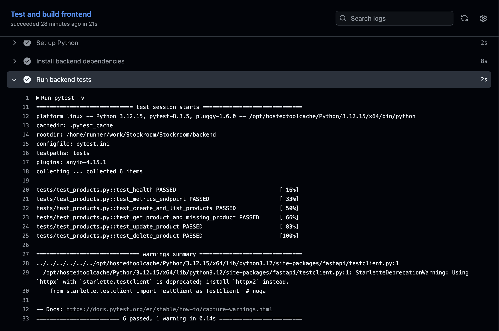</a></p>
<p align="center"><a href="evidence/commit-history.png">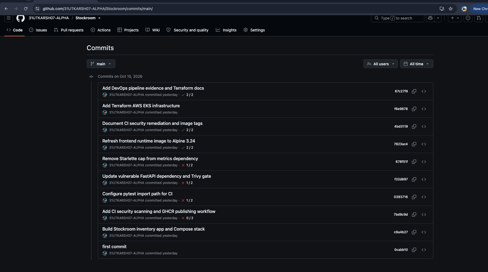</a></p>

### M4 — Docker

The Compose stack starts PostgreSQL, the FastAPI backend, and the Nginx-served frontend. Both runtime images use non-root users; the frontend image uses a Node build stage and Nginx runtime stage.

<p align="center"><a href="evidence/docker-compose-running.png">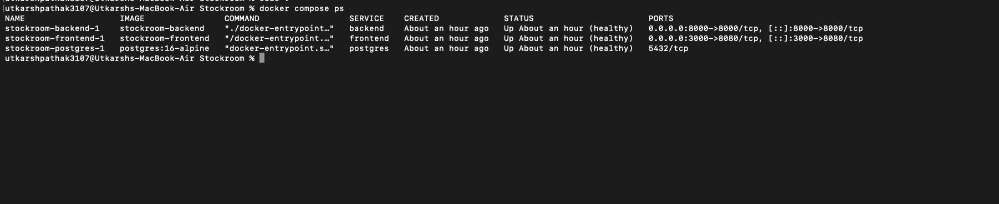</a></p>

### M5 — CI/CD and M6 — Trivy

The Actions screenshot shows the successful pipeline. GHCR screenshots show both published packages with commit-SHA tags. Trivy evidence is included for both images.

<p align="center">
  <a href="evidence/github-actions-green.png">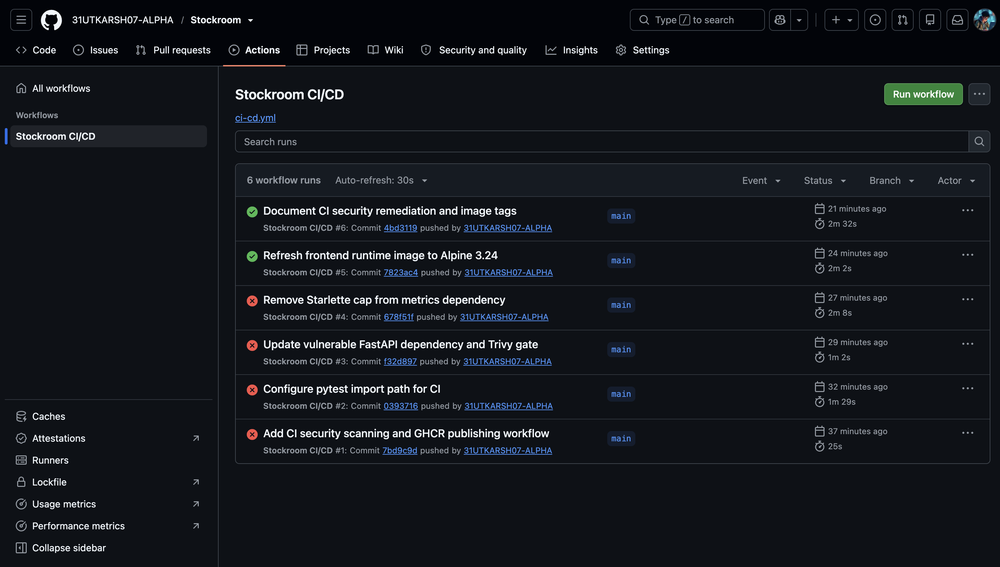</a>
  <a href="evidence/ghcr-backend-sha-tag.png">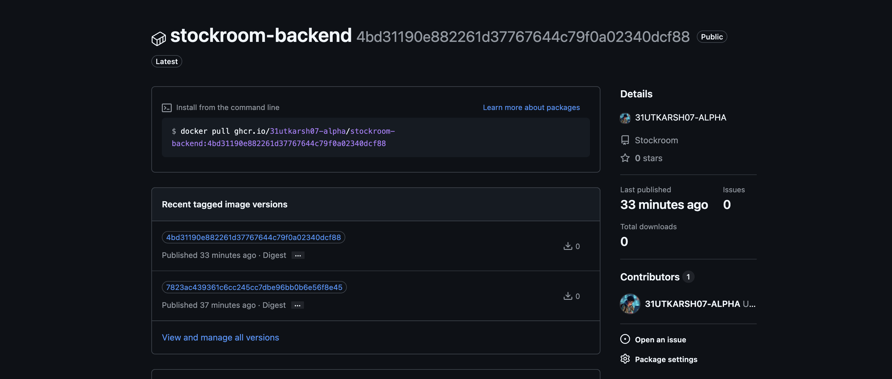</a>
</p>
<p align="center"><a href="evidence/ghcr-frontend-sha-tag.png">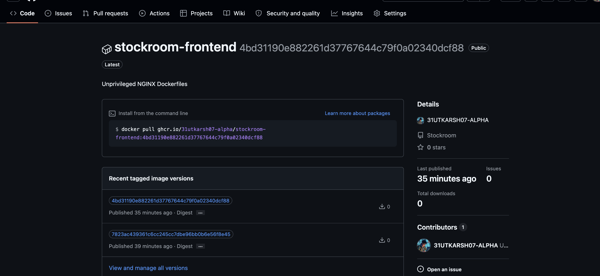</a></p>
<p align="center">
  <a href="evidence/trivy-backend-scan.png">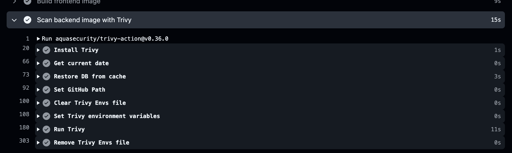</a>
  <a href="evidence/trivy-frontend-scan.png">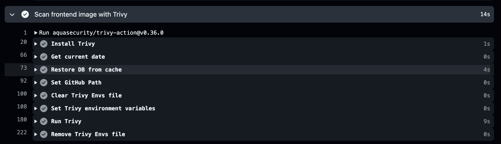</a>
</p>

### M7 — Terraform/AWS (partial)

Terraform configuration, initialization, validation, and an example variables file are present. AWS-only steps were skipped by design; the screenshot is explicitly local Terraform validation evidence, not proof of AWS deployment.

<p align="center"><a href="evidence/terraform-init-validate.png">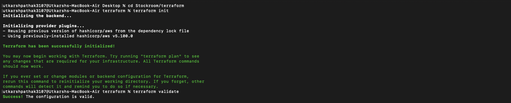</a></p>

### M8 — Kubernetes and Helm

The Stockroom Helm release runs in Kind with frontend and backend Deployments, ClusterIP Services, PostgreSQL, and Traefik Ingress. The frontend has two replicas; the backend scales from two to five replicas using CPU utilization.

<p align="center">
  <a href="evidence/k8s-pods-services.png">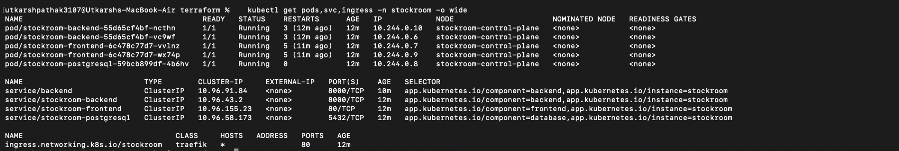</a>
  <a href="evidence/helm-release.png">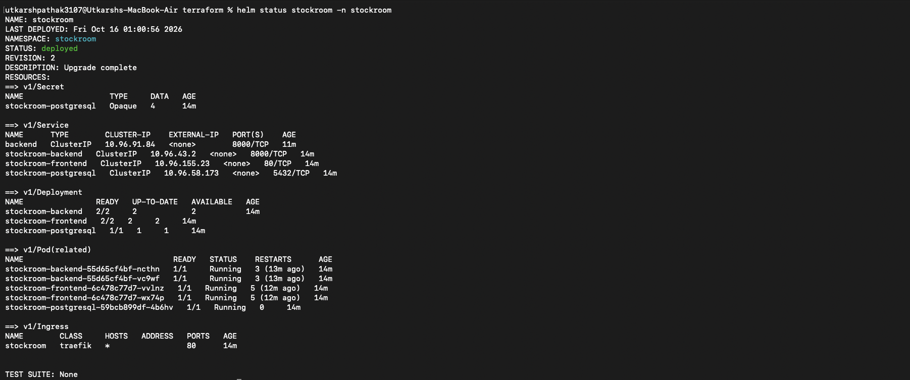</a>
</p>

The Kind metrics-server provides live resource metrics to the backend HPA. Under load, CPU crossed the 50% target and the HPA increased the backend from two replicas to five. After the load pod was removed, CPU returned below target and the HPA began scaling down.

<p align="center">
  <a href="evidence/hpa-metrics-server.png">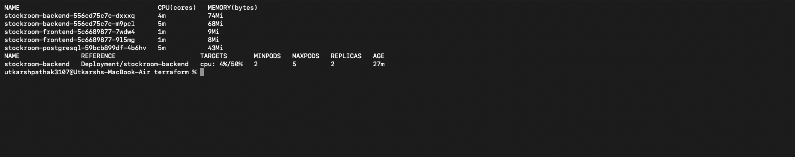</a>
  <a href="evidence/hpa-scaling-up.png">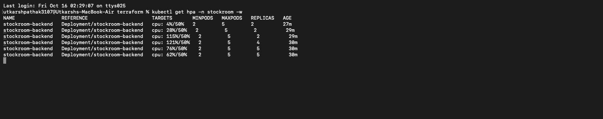</a>
</p>
<p align="center">
  <a href="evidence/hpa-scaled-pods.png">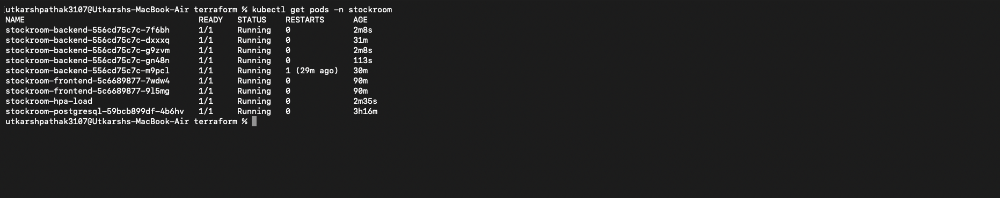</a>
  <a href="evidence/hpa-scaled-down.png">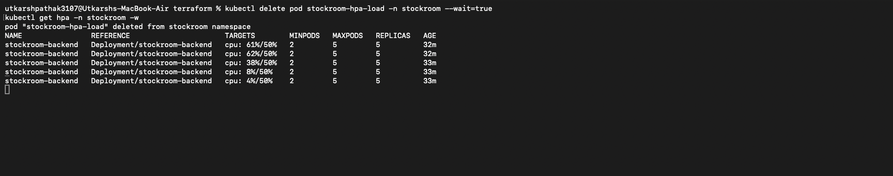</a>
</p>

### M9 — Prometheus and Grafana

The backend exposes Prometheus-formatted metrics. Prometheus discovers both backend replicas, and Grafana shows live request and latency data.

<p align="center"><a href="evidence/backend-metrics.png">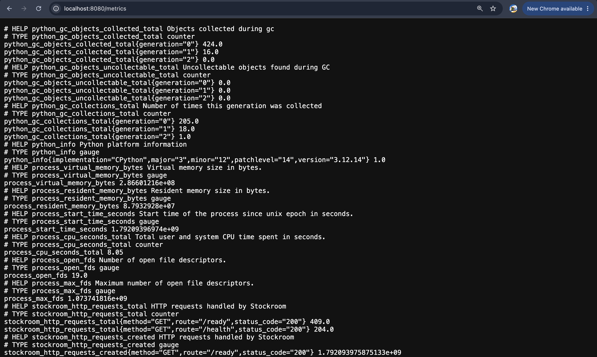</a></p>
<p align="center">
  <a href="evidence/prometheus-targets.png">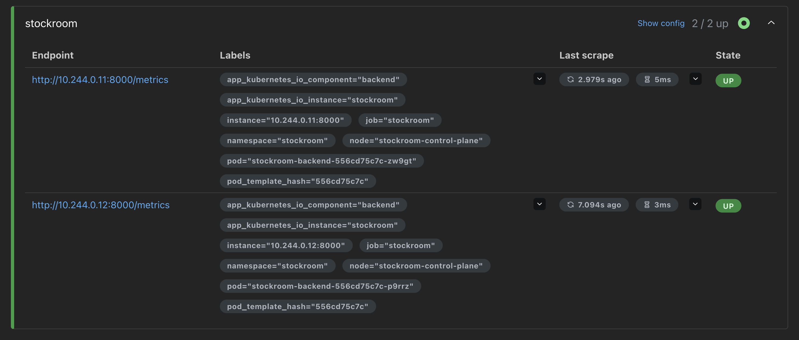</a>
  <a href="evidence/grafana-dashboard.png">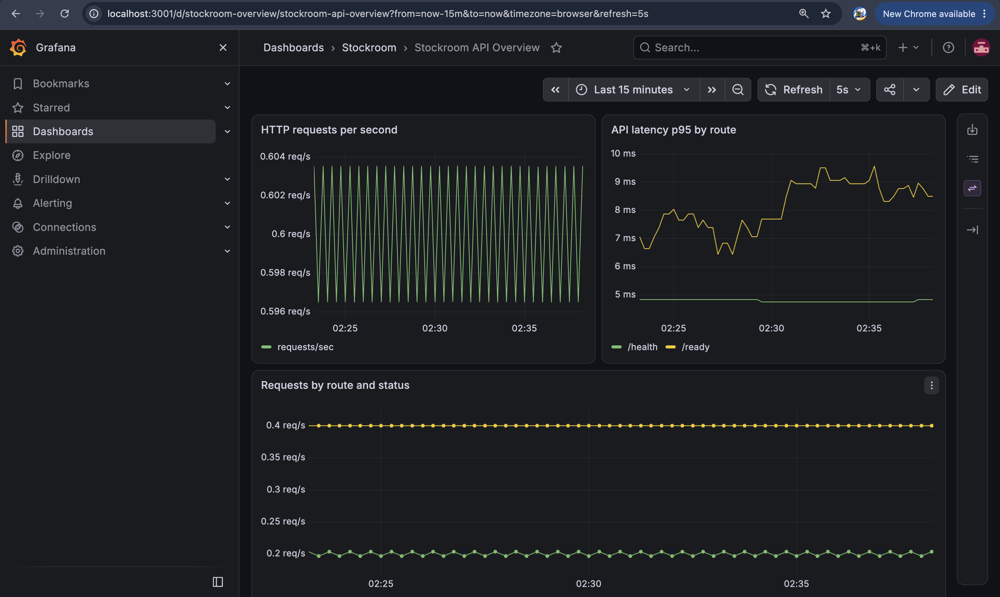</a>
</p>

### M10 — Demo and release evidence

The CSV screenshot shows the exported product data. The Actions run is green, and the Kind screenshot shows the frontend rolled out with the full commit SHA and two ready replicas. Follow [`DEMO.md`](DEMO.md) for the repeatable CRUD, pipeline, rollout, and observability walkthrough.

<p align="center"><a href="evidence/export-csv.png">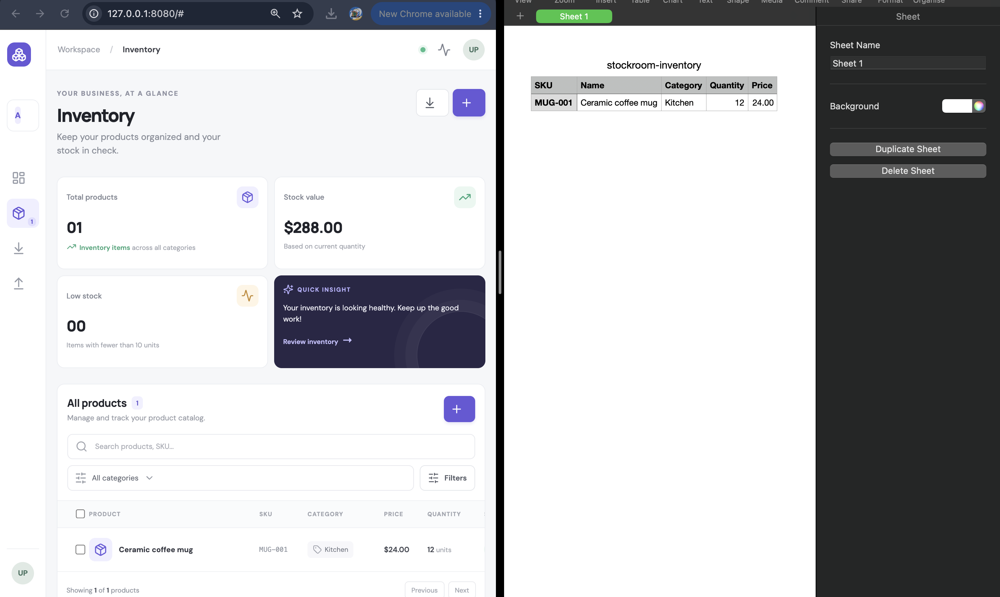</a></p>
<p align="center">
  <a href="evidence/actions-run.png">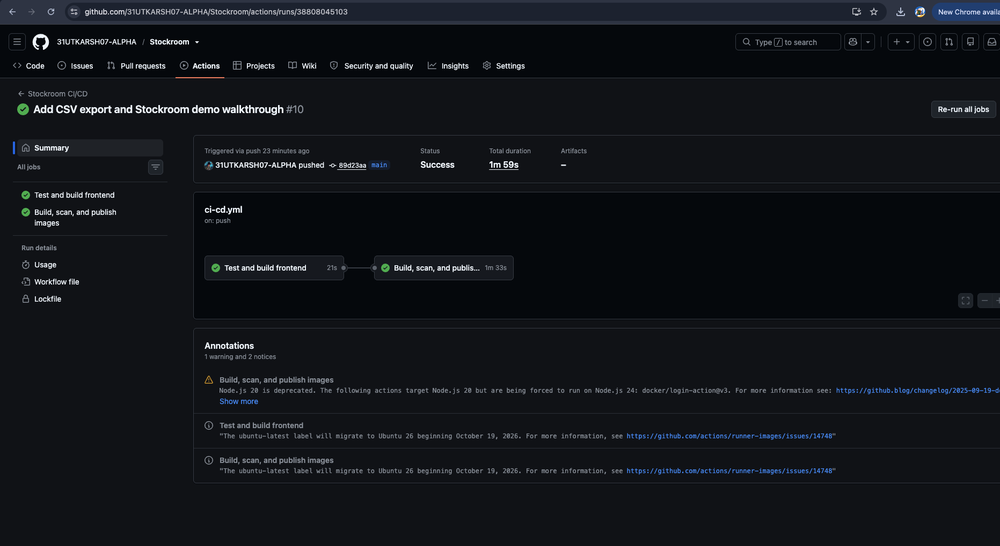</a>
  <a href="evidence/k8s-rollout.png">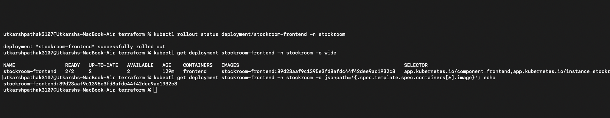</a>
</p>

## Repository map

```text
backend/                 FastAPI application, SQLAlchemy models, Alembic, Pytest
frontend/                React/Vite UI and Nginx runtime configuration
.github/workflows/       GitHub Actions test, build, Trivy, and GHCR workflow
helm/stockroom/          Kubernetes Helm chart
k8s/                     Kind cluster configuration and namespace
observability/            Prometheus and Grafana Helm values
terraform/                AWS VPC/EKS reference configuration (not applied)
evidence/                 Rubric screenshots (PNG)
DEMO.md                   Step-by-step presentation walkthrough
```

## Links

- [GitHub repository](https://github.com/31UTKARSH07-ALPHA/Stockroom)
- [GitHub Actions workflow](https://github.com/31UTKARSH07-ALPHA/Stockroom/actions/workflows/ci-cd.yml)
- [Demo walkthrough](DEMO.md)
- [AWS Terraform reference and cost notes](terraform/README.md)
